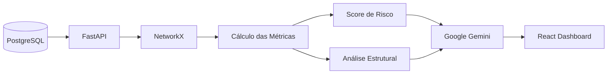

# 🧠 NexusLens


Plataforma inteligente para análise de redes financeiras utilizando Inteligência Artificial Generativa, Teoria dos Grafos e análise de redes, desenvolvida com FastAPI, React e PostgreSQL.

---

# 📑 Sumário

- Sobre o projeto
- Funcionalidades
- Tecnologias
- Arquitetura
- Como executar
- Estrutura
- Endpoints
- Inteligência Artificial
- Teoria dos Grafos
- Resultados
- Objetivo
- Aprendizados
- Melhorias futuras

---

# 📌 Sobre o projeto

O **NexusLens** é uma plataforma desenvolvida para auxiliar analistas financeiros na identificação de padrões de risco em redes de transações.

O projeto combina **Teoria dos Grafos**, **Análise de Redes** e **Inteligência Artificial** para transformar dados financeiros em informações estratégicas, permitindo identificar possíveis comportamentos suspeitos e gerar recomendações automáticas.

Toda a análise é realizada a partir de uma rede de transações financeiras, onde os clientes são representados como nós e as transações como conexões entre eles.

Além da análise estrutural da rede, o sistema utiliza a API do **Google Gemini** para gerar relatórios inteligentes em linguagem natural.

---

## 🌐 Deploy

- **Frontend:** https://nexuslens-frontend.vercel.app
- **API:** https://nexuslens-api.onrender.com
- **Swagger:** https://nexuslens-api.onrender.com/docs

> O dashboard permite visualizar métricas da rede financeira, o grafo de transações e relatórios inteligentes gerados por IA em tempo real.

---

# ✨ Funcionalidades

A plataforma oferece as seguintes funcionalidades:

- Construção de redes financeiras utilizando Teoria dos Grafos
- Cálculo automático do Score de Risco
- Classificação do nível de risco
- Identificação da influência de clientes na rede
- Geração automática de recomendações
- Geração de relatórios inteligentes utilizando IA
- Dashboard interativo para visualização dos resultados
- API REST desenvolvida com FastAPI
- Persistência dos dados em PostgreSQL

---

## 🛠️ Tecnologias utilizadas

| Tecnologia | Finalidade |
|------------|------------|
| Python 3 | Linguagem principal |
| FastAPI | Desenvolvimento da API |
| React | Interface da aplicação |
| Axios | Comunicação Front-end / API |
| SQLAlchemy | ORM |
| PostgreSQL | Banco de dados |
| NetworkX | Construção e análise dos grafos |
| Google Gemini API | Geração dos relatórios inteligentes |
| Docker | Containerização |
| Render | Deploy do Back-end |
| Vercel | Deploy do Front-end |
| Git | Controle de versão |

---

# 🏗️ Arquitetura



---

# ⚙️ Como executar o projeto

## 1. Clone o repositório

```bash
git clone https://github.com/isabelleferreiraa/NexusLens.git
```

## 2. Entre na pasta do projeto

```bash
cd NexusLens
```

---

## 🐳 Opção 1 — Execução com Docker

```bash
docker compose up --build
```

---

## ▶️ Opção 2 — Execução Local

### Backend

```bash
cd backend

python -m venv .venv
```

Ative o ambiente virtual.

Instale as dependências.

```bash
pip install -r requirements.txt
```

Execute a API.

```bash
uvicorn app.main:app --reload
```

---

### Frontend

```bash
cd frontend

npm install

npm run dev
```

---

# 📂 Estrutura do projeto

```text
nexuslens/
│
├── backend/
│   ├── app/
│   │   ├── services/
│   │   │   ├── analise_grafo.py
│   │   │   ├── grafo.py
│   │   │   ├── ia.py
│   │   │   └── score.py
│   │   │
│   │   ├── database.py
│   │   ├── main.py
│   │   ├── models.py
│   │   ├── schemas.py
│   │   └── __init__.py
│   │
│   ├── database/
│   │   └── init.sql
│   │
│   ├── .env.example
│   ├── Dockerfile
│   ├── requirements.txt
│   └── .gitignore
│
├── frontend/
│   ├── public/
│   │   ├── favicon.svg
│   │   └── icons.svg
│   │
│   ├── src/
│   │   ├── assets/
│   │   │   ├── hero.png
│   │   │   ├── react.svg
│   │   │   └── vite.svg
│   │   │
│   │   ├── components/
│   │   │   ├── AIInsights/
│   │   │   │   ├── AIInsights.css
│   │   │   │   └── AIInsights.jsx
│   │   │   │
│   │   │   ├── GraphView/
│   │   │   │   ├── GraphView.css
│   │   │   │   └── GraphView.jsx
│   │   │   │
│   │   │   ├── Header/
│   │   │   │   ├── Header.css
│   │   │   │   └── Header.jsx
│   │   │   │
│   │   │   ├── MetricsPanel/
│   │   │   │   ├── MetricsPanel.css
│   │   │   │   └── MetricsPanel.jsx
│   │   │   │
│   │   │   └── StatCard/
│   │   │       ├── StatCard.css
│   │   │       └── StatCard.jsx
│   │   │
│   │   ├── pages/
│   │   │   └── Dashboard.jsx
│   │   │
│   │   ├── services/
│   │   │   └── api.js
│   │   │
│   │   ├── styles/
│   │   │   ├── dashboard.css
│   │   │   └── global.css
│   │   │
│   │   ├── App.jsx
│   │   └── main.jsx
│   │
│   ├── package.json
│   ├── package-lock.json
│   ├── vite.config.js
│   ├── Dockerfile
│   └── .gitignore
│
├── docker-compose.yml
├── LICENSE
└── README.md
```

---

# 📡 Endpoints

| Método | Endpoint | Descrição |
|----------|----------|------------|
| GET | / | Status da API |
| GET | /clientes | Lista de clientes |
| GET | /transacoes | Lista de transações |
| GET | /grafo | Geração da análise financeira |

---

# 🧠 Inteligência Artificial

O NexusLens utiliza a API do **Google Gemini** para interpretar automaticamente os resultados obtidos pela análise da rede financeira.

A IA recebe um resumo contendo métricas da rede e gera um relatório em linguagem natural apresentando:

- Identificação do nível de risco;
- Interpretação das conexões;
- Possíveis padrões suspeitos;
- Recomendações para o analista financeiro.

---

# 🌐 Teoria dos Grafos

A rede financeira é representada utilizando grafos.

Na modelagem:

- Nós representam clientes;
- Arestas representam transações financeiras.

A partir dessa estrutura são calculadas métricas como:

- Influência na rede;
- Quantidade de conexões;
- Papel estrutural do cliente;
- Score de risco.

---

## 📊 Resultado

A plataforma entrega ao analista:

- ✅ Dashboard interativo
- ✅ Visualização da rede financeira
- ✅ Score de risco calculado automaticamente
- ✅ Classificação do nível de risco
- ✅ Métricas estruturais da rede
- ✅ Recomendações inteligentes
- ✅ Relatório gerado pela IA (Google Gemini)
- ✅ Persistência dos dados em PostgreSQL

---

# 🎯 Objetivo do projeto

Desenvolver uma plataforma inteligente capaz de transformar dados de redes financeiras em informações estratégicas por meio da combinação entre Inteligência Artificial Generativa, Teoria dos Grafos e Engenharia de Software, auxiliando analistas na identificação de padrões de risco e apoiando a tomada de decisão.

---

# 💡 Aprendizados

- Desenvolvimento de APIs REST com FastAPI
- Construção de interfaces com React
- Integração entre Front-end e Back-end
- Modelagem de banco de dados PostgreSQL
- Aplicação de Teoria dos Grafos utilizando NetworkX
- Integração com IA Generativa (Google Gemini)
- Containerização com Docker
- Deploy completo da aplicação utilizando Vercel (Frontend), Render (Back-end) e Neon (Banco de Dados PostgreSQL)

---

# 🔮 Melhorias futuras

- Histórico das análises realizadas
- Exportação de relatórios em PDF
- Sistema de autenticação de usuários
- Atualização da rede em tempo real
- Dashboard analítico avançado
- Filtros inteligentes na rede financeira
- Upload de arquivos CSV para análise personalizada
  
---

# 👨‍💻 Autora

**Isabelle Ferreira Neri Feitoza**

Estudante de Análise e Desenvolvimento de Sistemas — FIAP  

- [LinkedIn](https://www.linkedin.com/in/isabelle-ferreira-8844593ab/)
- [GitHub](https://github.com/isabelleferreiraa)
